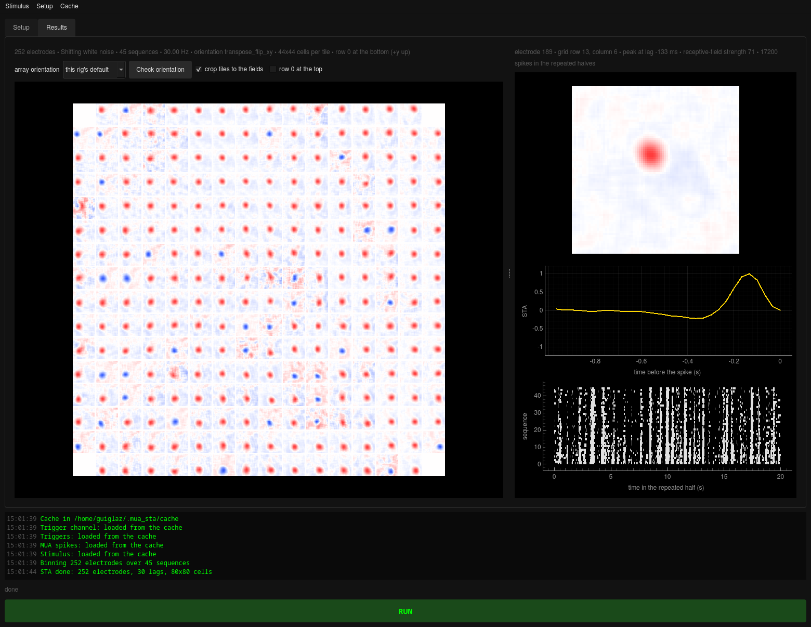
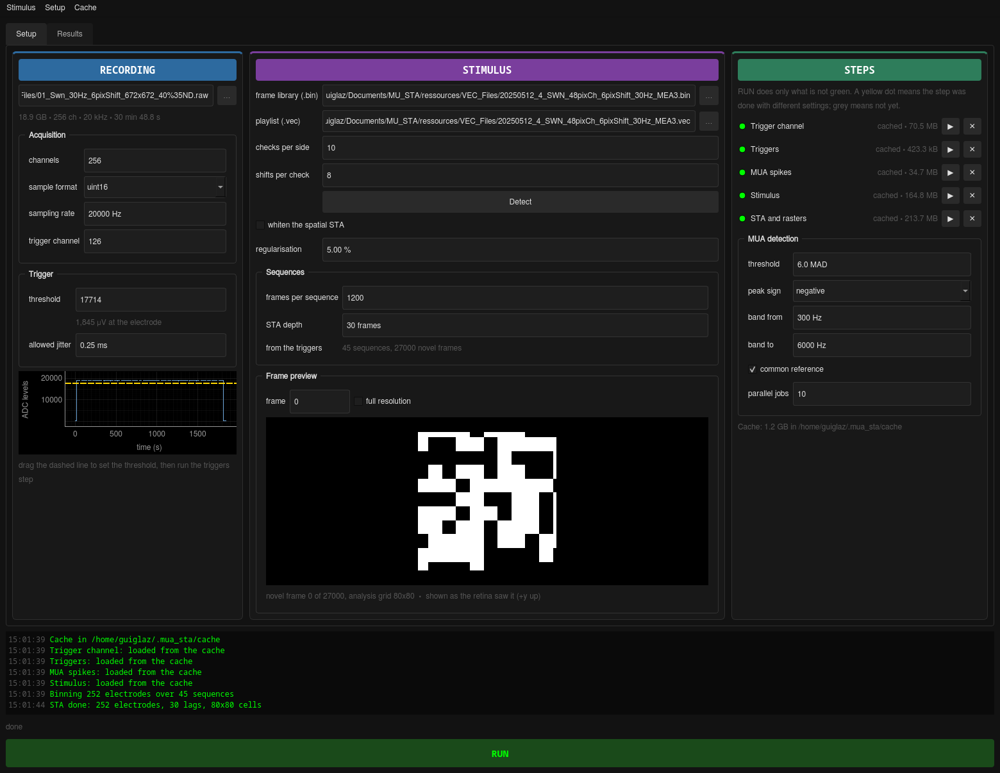

# MUA_STA

Multi-unit spike-triggered averages from a 256-channel MEA recording, meant to be run **during
an experiment**: pick a recording, say which stimulus was shown, and get a 16×16 grid of
multi-unit receptive fields while the retina is still alive.

It handles both stimuli the standard analysis pipeline supports:

- **Checkerboard** — checks drawn from the `binarysource1000Mbits` bit stream.
- **Shifting white noise (SWN)** — a `.bin` frame library played in the order given by a `.vec`.



*A 30-minute shifting-white-noise recording on MEA3: one multi-unit receptive field per
electrode, their positions tracking the array. Whitening is off in this shot — see below.*

---

## Installing

```bash
conda env create -f environment.yml     # creates the 'mua_sta' environment
conda activate mua_sta
python -m mua_sta
```

Or just run the launcher for your platform — it creates the environment on first use:

| | |
|---|---|
| Linux | `./MUA_STA.sh` (or the `MUA_STA.desktop` shortcut) |
| Windows | double-click `MUA_STA.bat` |

The GUI remembers its settings in `~/.mua_sta/config.json`, and its log goes to
`~/.mua_sta/mua_sta.log`.

---

## Using it

### The menu bar

- **Stimulus** — *Checkerboard* or *Shifting white noise*. The middle card follows.
- **Setup** — *MEA1 / MEA2 / MEA3*. This sets the trigger threshold, the DMD geometry and
  pixel size, and the display polarity and optics. A rig whose display settings have not been
  verified says so.
- **Cache** — open the cache folder, or forget this recording's steps, or all of them.

### The three cards

**RECORDING** — the `.raw` file, the acquisition settings, and the trigger threshold. Once the
trigger-channel step has run, the trace is plotted underneath with the threshold as a dashed
line: **drag the line** to set the threshold over the real pulses instead of guessing a number.

**STIMULUS** — the stimulus files and geometry, the sequence layout, and a frame preview. The
preview shows a frame *as the retina saw it*, either on the analysis grid (what actually feeds
the STA) or at **full resolution**, which is the frame to compare against the lab's
StimulusDisplayer when checking orientation.



**STEPS** — one row per step of the pipeline, with a dot saying whether it is usable:

| dot | meaning |
|---|---|
| green | done, with the settings currently in the window |
| yellow | done, but with *different* settings — it will be redone |
| grey | not done yet |

`RUN` does only what is not green. `▶` redoes one step on its own; `✕` forgets its result.

### Why the steps are split where they are

Reading the trigger channel is a pass over a ~19 GB file and detecting MUA spikes is a pass
over all 256 channels of it. Both are cached on **only** what they actually depend on:

| step | depends on | so changing this does *not* redo it |
|---|---|---|
| Trigger channel | the file, channel count, sample format, trigger channel | **the threshold** |
| Triggers | the above + threshold, allowed jitter | anything about the stimulus |
| MUA spikes | the file + detection band, threshold, peak sign, reference | **every stimulus and analysis parameter** |
| Stimulus | the stimulus files + checks, shifts, setup | the recording, the spikes |
| Covariance | the stimulus + regularisation | — |
| STA and rasters | all of the above + sequence layout, STA depth | — |

So mistyping the check count costs the stimulus rebuild and the STA, not the spike detection.
Caches live in `~/.mua_sta/cache`; the STEPS card shows how much they take.

---

## The two stimuli

### Checkerboard

Checks come from the binary source, bit 0 onwards, least significant bit first within a byte,
row-major inside a frame. Only the novel half of each sequence is drawn from it, so the tool
reads `sequences × frames_per_sequence / 2` frames.

Type in the number of checks per side and how many DMD pixels wide a check was — both come
from the stimulus, usually from its file name (`..._16px_42sq_...` is 42 checks of 16 px). The
check width only sets the micrometres the result is reported in: 16 px on MEA3 is 40 µm.

### Shifting white noise

The `.vec` is the playlist — one row per displayed frame, column 1 being the index into the
`.bin`. A sequence is a novel half then a repeated half; the novel frames are the lower half of
the index range, **shuffled**, so the `.vec` is what tells you which frame was shown when.

Each frame is a checkerboard whose grid is offset by a whole number of *shift steps*, a shift
step being a fraction of a check. The analysis grid therefore has one cell per shift step:
`checks per side × shifts per check` cells each way. Sampling at the **centre of each cell** is
exact rather than an approximation — because the grid only ever moves by whole shift steps,
every check edge lands on a cell boundary, so a cell always sits inside a single check.

**Type the checks per side in** (it comes from the stimulus design); **Detect** measures both
numbers from the frames and fills them in. Getting the shift count right matters: for the MEA3
library `20250512_4_SWN_48pixCh_6pixShift_30Hz_MEA3.bin`, the frames are drawn at 672 px for a
480 px design, so a check is 67.2 px and a shift step 8.4 px — 10 checks of 8 shifts, an 80×80
grid at 21 µm per cell. `frame[::6, ::6]`, which the standard pipeline's `swn_shift_x = 6`
gives on that file, samples that 80-cell stimulus on a misaligned 112-sample lattice: it mixes
in the soft pixels at the check edges and invents short-range correlations. The GUI warns when
the numbers you gave cannot be the design, by noticing that the sampled frames are not purely
black and white.

### Whitening

SWN frames are spatially correlated — with `s` shifts per check, two cells `d` steps apart
share a check with probability `1 − d/s` — so the raw STA is the receptive field blurred by the
stimulus's own covariance. **whiten the spatial STA** divides that back out (`C⁻¹·STA`, the
linear-regression estimate of the filter). The covariance is a property of the *stimulus*,
identical for every electrode, so it is factorised once and reused for all 252 of them: the
same answer as solving per electrode, and hundreds of times faster. **Regularisation** is a
percentage of the pixel variance, so it means the same thing whatever the contrast — unlike
the standard pipeline's fixed `sigma = 5.0`, which is about twenty times the variance of a
black-and-white stimulus and leaves the whitening doing nothing at all.

> **On multi-unit data it usually makes things worse, and it is on by default.** Measured on
> `20251013_PupilSize/01_Swn` (252 electrodes, 9.1 M spikes), sweeping sigma from 0.5 % to
> 2000 %: unwhitened, receptive-field quality is 36 and electrode position predicts field
> position at r = +0.98; whitened at 5 %, quality drops to 6 and r to +0.11, with the peaks
> scattered over the whole field. It only recovers as sigma grows large enough to make the
> whitening a no-op. The reason is that a shifting stimulus's covariance carries very little
> variance at high spatial frequencies, so its inverse amplifies them — and a multi-unit STA,
> pooled over everything the electrode picked up, is noisy there. It is worth having for
> comparing against the standard pipeline's sorted single-cell STAs, which are far cleaner.
> The tool measures the before and after and says so in the log when whitening has cost you,
> and the unwhitened STA is always kept alongside, so **untick it** if the grid looks like
> noise.

Checkerboard frames are already uncorrelated, so there is nothing to whiten and the step does
not appear.

---

## Orientation

There are two separate questions, and only the first was ever handled.

**How the stimulus looked on the retina.** One table, `mua_sta/rigs.py`, holds each rig's
display polarity and optical transform, and one function applies them — to the checkerboard and
to SWN alike, so the two cannot disagree. It is the same table and the same order as the lab's
StimulusDisplayer, so a frame in the preview is the frame that was projected. To check it end
to end, open the same `.bin`/`.vec` in the StimulusDisplayer and in the **full resolution**
frame preview at the same frame index and confirm they match.

**How the array sits in that frame.** No stimulus file can tell you this one: it is a property
of the setup. It is measured from the data instead, by the fact that an electrode's position on
the array has to predict where its receptive field is — which holds under exactly one of the
eight ways two image frames can be related. **Check orientation** on the Results tab tries all
eight and reports them. On MEA3 the answer is `transpose_flip_xy` at r = +0.98, with the next
best at +0.12: a transpose and two flips away from the identity the previous version of this
tool assumed. That default is in `rigs.py`; MEA1 and MEA2 are still `identity` and
**unverified** — run Check orientation on a recording from them and put the answer there.

Results are then drawn with **+y up**: electrode row 0 (y = 0 in the probe file) is at the
bottom of the grid, and so is row 0 of each tile. That matches the receptive-field frame the
standard analysis pipeline uses and the four-squares orientation check ("the cells whose
receptive field is at the top respond to the top square").

The overview crops every tile to the window the receptive fields actually fall in, measured
from the data: the stimulus covers far more retina than the array does (1680 µm against 480 µm
on MEA3), so otherwise most of each tile is empty and the shift between neighbours is a few
cells in eighty. Untick **crop tiles to the fields** to see the whole stimulus field.

## What changed from the previous version

The two command-line scripts (`STA_MU_Exec.py`, `STA-Swan_MU_Exec.py`) are replaced by the
`mua_sta` package and this GUI. Four fixes change the numbers, so results are **not** directly
comparable with older runs:

- **Electrodes were off by one.** Spike trains were keyed by spikeinterface's 0-based
  `channel_index` while the electrode map is keyed by 1-based MCS label, so every STA was
  attributed to the next electrode along.
- **MEA3 polarity was not applied to the checkerboard.** `DMD_POLARITY = -1` was dead code and
  the equivalent line is commented out in the pipeline's `checkerboard.py`, so MEA3 checkerboard
  STAs came out sign-flipped — ON cells reading as OFF. They now agree with SWN.
- **Binning drifted.** 600 bins were laid over the 599 frame intervals between the first and
  last trigger of a half-sequence, so bin *k* drifted from frame *k* by up to half a frame by
  the end of a sequence, and the last frame's spikes were dropped. Bin edges are now the
  triggers themselves.
- **The grid was mirrored** against the pipeline's receptive-field frame, and the array's own
  orientation in the stimulus was never accounted for at all (see *Orientation*).

Faster, too: the STA is a matrix product per sequence and lag rather than one slice addition
per spike bin, and the trigger channel is read with one strided memory-map pass.

---

## Tests

```bash
conda activate mua_sta
pytest
```

They cover the rig transforms (including a frame that is not square, where a fixed axis order
is right for one rig and wrong for the other), the SWN lattice detector against a library
rendered at a fractional scale, the fast STA against a plain reference loop, the whitening on a
synthetic shifting stimulus, what the cache considers stale, and the window itself headless.

---

## Next

Recordings arrive as `.mcd` and are converted to `.raw` with MC_DataTool by hand, which costs
time and doubles the disk use. Reading the `.mcd` directly is the next piece of work; the
format is a simple chunked container whose electrode payloads are byte-identical to the `.raw`,
so this tool will read it and the `.raw` step will go away.
