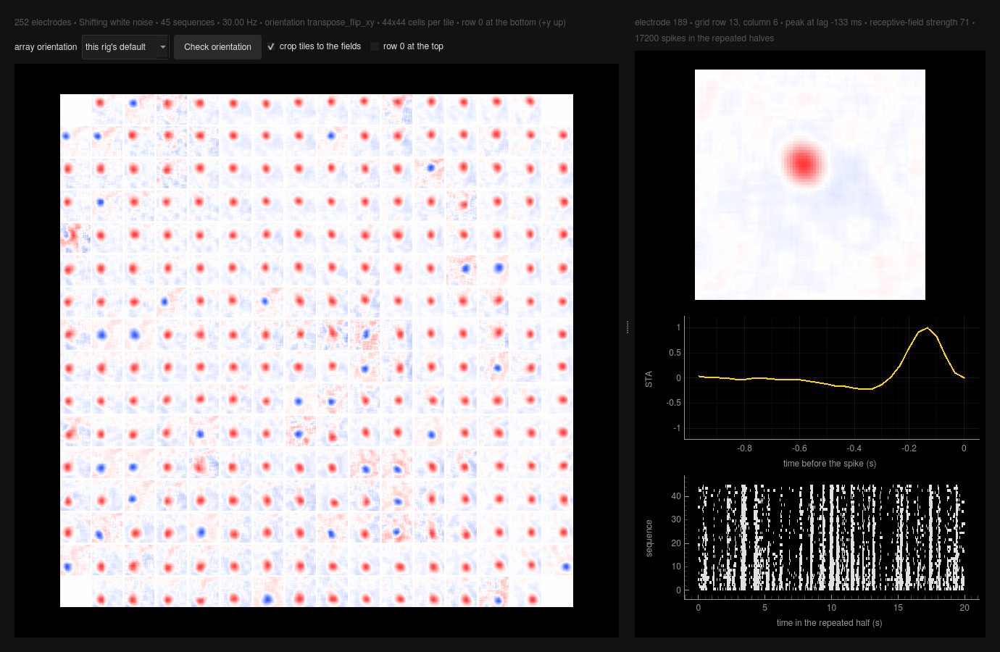

# MUA_STA

Multi-unit spike-triggered averages from a 256-channel MEA recording, meant to be run **during
an experiment**: pick a recording, say which stimulus was shown, and get a 16×16 grid of
multi-unit receptive fields while the retina is still alive.

It handles both stimuli the standard analysis pipeline supports:

- **Checkerboard** — checks drawn from the `binarysource1000Mbits` bit stream.
- **Shifting white noise (SWN)** — a bin file of noise frames, shown in the order a vec file gives.


Load a recording, press RUN. Everything that does not change between experiments — 256 uint16
channels at 20 kHz, the visual trigger channel, each rig's trigger threshold, the
spike-detection band — lives in the code or in the per-rig table, not on screen.

---

## Installing

```bash
conda env create -f environment.yml     # creates the 'mua_sta' environment
conda activate mua_sta
python -m mua_sta
```

Or just run the launcher for your platform — it creates the environment on first use:

| | |
|---|---|
| Linux | `./MUA_STA.sh` from a terminal, or `./MUA_STA.sh --install-shortcut` once to get something to click |
| Windows | double-click `MUA_STA.bat` |

**On Linux, run `--install-shortcut` once.** Recent GNOME will not run a `.sh` from the file
manager at all: double-clicking one opens it in a text editor, and "Run as a Program" is gone
from the right-click menu. The option installs a proper launcher in two places — the
application menu (press Super and type "MUA STA") and the desktop. The desktop icon needs
**Allow Launching** from its own right-click menu once; only the desktop may set that, so no
script can do it for you. The application-menu entry needs nothing.

Both launchers call the environment's own interpreter by its full path rather than relying on
`conda activate` plus whatever `python` is first on PATH — on a machine whose profile puts
another environment early on PATH, that silently runs the wrong Python and the only sign is an
`ImportError` in the log. `MUA_STA.sh` also checks the environment imports before detaching, so
a broken one is reported in the terminal instead of in a log nobody reads.

The GUI remembers its settings in `~/.mua_sta/config.json`, and its log goes to
`~/.mua_sta/mua_sta.log`.

---

## Using it

**Stimulus**, at the top: a two-position switch. *Checkerboard* asks for the binary source and
how many squares per side; *Shifting white noise* asks for the vec file and the bin file
and nothing else — the lattice is measured from the frames themselves and reported on the
status line. The stimulus frequency is read off the triggers either way.

**Setup**, below it: MEA 1, 2 or 3. This sets the trigger threshold, the DMD geometry and pixel
size, the display polarity and optics, and how the array sits in the stimulus. Next to it is
the trigger channel, 126 — the visual trigger, the same one the standard pipeline reconstructs
from.

**Recording**: the `.raw` file, with its size and duration underneath.

**The three lines** are the run, split where the work is:

| line | what it does |
|---|---|
| Triggers and spikes | everything about the file: reads the trigger channel, finds the onsets, detects the MUA |
| Stimulus | rebuilds what was shown, and its covariance if whitening is on |
| STA | bins the spikes against it and computes the spike-triggered averages |

Each has a dot — **green** done, **red** has to be redone, **grey** not done yet — a **▶** that
runs just that line, an **✕** that forgets it, and one button to look at what it produced: the
trigger trace, a stimulus frame, or the results.

**RUN** does the lot. If any of it has already been done it asks first whether to redo
everything from the start; to redo only one line, use that line's ▶. While something is
running the same button reads **STOP**.

**The status line** reports like `tqdm` does — what is running, how far along it is, how long
it has taken and how much is left: `detecting spikes  47%  00:33<00:36`. The bar below fills
with it, or spins for the few steps that cannot say how long they are. The estimate comes from
the rate so far, so it settles quickly: on a 30-minute recording the spike detection predicted
1:16 at 5 % and finished in 1:09.

**STOP** ends the run at the next piece of work, keeping whatever already finished. Spike
detection is handed to a pool of processes that cannot be interrupted once started, so the
recording is detected in pieces of about four minutes each and stopping takes at most one of
them; the noise levels are measured once over the whole recording and shared, so detecting in
pieces gives the same spikes as detecting in one go.

The **gear** holds what is rarely worth touching: the MUA detection band, threshold, peak sign
and job count; the sequence length and STA depth; whitening and its regularisation; the
checkerboard's check width; and the cache (how big it is, where it is, and how to empty it).

The **status line** at the bottom shows the last thing that happened, in red if it was a
warning. The full timestamped log goes to `~/.mua_sta/mua_sta.log`.

### Why the three lines are split that way

Reading the trigger channel is a pass over a ~19 GB file and detecting MUA spikes is a pass
over all 256 channels of it, so underneath each line the steps are cached separately, on only
what they actually depend on. Changing the setup changes that rig's trigger threshold, so the
triggers go stale while the trace stays valid — the *Triggers and spikes* line turns red and ▶
re-detects the onsets in a fraction of a second instead of reading the file again. Nothing
about the stimulus or the analysis can ever force the spike detection to run a second time.
Caches live in `~/.mua_sta/cache`; the gear says how much they take.

### The results



They open in their own window when a run finishes, and the **⊞** button on the STA line brings
them back. Every electrode's receptive field is tiled onto the array, each tile carrying its
MCS number; click one to see it larger, with its temporal profile and its raster over the
repeated halves. The selected electrode is marked by a square rather than a caption, and the
top-left electrode is selected to begin with so the detail is never blank — the very corner of
this array is a reference channel, so that is the first one along with data.

There is nothing to set. The stimulus axes are placed on the electrode grid by the rig's own
registration, the way its polarity and optics are (see *Orientation*), and the tiles are always
cropped to the window the receptive fields actually fall in — measured from the data, from the
unwhitened STA where the fields are unambiguous. **Save image** writes the figure as it stands
to a PNG, PDF or SVG of your choosing.

The figure is matplotlib, drawn the way the standard pipeline draws these — same `RdBu_r`
colour map, same time vector for the temporal STA (one bin per displayed frame, ending at the
spike).

## The two stimuli

### Checkerboard

Checks come from the binary source, bit 0 onwards, least significant bit first within a byte,
row-major inside a frame. Only the novel half of each sequence is drawn from it, so the tool
reads `sequences × frames_per_sequence / 2` frames.

Type in the number of squares per side; it comes from the stimulus, usually from the recording's
file name (`..._16px_42sq_...` is 42 checks of 16 px). The check width, the `16px` in that name,
is in the gear: it only sets the micrometres the result is reported in — 16 px on MEA3 is 40 µm
— and changes nothing that is computed.

### Shifting white noise

The vec file says what was shown when — one row per displayed frame, column 1 being the index
into the bin file. A sequence is a novel half then a repeated half; the novel frames are the lower half of
the index range, **shuffled**, so the `.vec` is what tells you which frame was shown when.

Each frame is a checkerboard whose grid is offset by a whole number of *shift steps*, a shift
step being a fraction of a check. The analysis grid therefore has one cell per shift step:
`checks per side × shifts per check` cells each way. Sampling at the **centre of each cell** is
exact rather than an approximation — because the grid only ever moves by whole shift steps,
every check edge lands on a cell boundary, so a cell always sits inside a single check.

**Nothing has to be typed in**: the two numbers are measured from the frames themselves. That
happens when the Stimulus step runs, not when the file is chosen — nothing reads a stimulus
until it is asked to — and the step reports what it found. Getting the shift count right matters: for the MEA3
library `20250512_4_SWN_48pixCh_6pixShift_30Hz_MEA3.bin`, the frames are drawn at 672 px for a
480 px design, so a check is 67.2 px and a shift step 8.4 px — 10 checks of 8 shifts, an 80×80
grid at 21 µm per cell. `frame[::6, ::6]`, which the standard pipeline's `swn_shift_x = 6`
gives on that file, samples that 80-cell stimulus on a misaligned 112-sample lattice: it mixes
in the soft pixels at the check edges and invents short-range correlations. The GUI warns when
the numbers you gave cannot be the design, by noticing that the sampled frames are not purely
black and white.

### Whitening

SWN frames are spatially correlated — with `s` shifts per check, two cells `d` steps apart
share a check with probability `1 − d/s` — so the raw STA is the receptive field blurred by the
stimulus's own covariance. **whiten the spatial STA**, in the gear, divides that back out
(`C⁻¹·STA`, the linear-regression estimate of the filter), computed exactly as the standard
pipeline's `decorrelate_spatial_stas` does: `C = np.cov(stimulus)` with pixels in 0..1, then
`np.linalg.solve(C + σ·I, spatial_sta)` with the pipeline's **σ = 5.0**
(`swn_cov_regularization`), which the gear's **regularisation** sets. The covariance is a
property of the *stimulus*, identical for every electrode, so it is factorised once and reused
for all 252 of them: the same answer as solving per electrode, and hundreds of times faster.
Each whitened map is then divided by its largest value so the grid draws it on the same scale
as the raw one. The stimulus it is computed on is this tool's 80x80 cell-centre lattice, not
the pipeline's `frame[::6, ::6]` (see above), so on MEA3 the numbers differ from the
pipeline's by that, and by nothing in the whitening itself.

> **σ is measured against the covariance's eigenvalues, not the pixel variance.** On an 80x80
> SWN grid, where a check spans 8x8 cells, they run from ~16 down to almost nothing at the
> spatial frequencies the stimulus barely carries. At σ = 5.0 the receptive fields come out
> somewhat tighter than the raw STA's; at a few hundredths, those nearly empty frequencies are
> amplified a thousandfold and a multi-unit STA, pooled over everything the electrode picked
> up, is buried under its own noise. The tool measures the before and after and says so on the
> status line and in the log when whitening has cost you, and the unwhitened STA is always kept
> alongside, so **untick it in the gear** if the grid looks like noise.

Checkerboard frames are already uncorrelated, so there is nothing to whiten and the step does
not appear.

---

## Orientation

There are two separate questions, and only the first was ever handled.

**How the stimulus looked on the retina.** One table, `mua_sta/rigs.py`, holds each rig's
display polarity and optical transform, and one function applies them — to the checkerboard and
to SWN alike, so the two cannot disagree. It is the same table and the same order as the lab's
StimulusDisplayer, so a frame in the preview is the frame that was projected. To check it end to
end, open the same `.bin`/`.vec` in the StimulusDisplayer and in the **▣** button's preview — with
**full resolution** ticked — at the same frame index, and confirm they match.

**How the array sits in that frame.** No stimulus file can tell you this one: it is a property
of the setup, like the polarity and the optics, so it lives in `rigs.py` next to them and is
applied automatically. It was *measured* rather than assumed, by the fact that an electrode's
position on the array has to predict where its receptive field is — which holds under exactly
one of the eight ways two image frames can be related. On MEA3 the answer is
`transpose_flip_xy` at r = +0.98, with the next best at +0.12: a transpose and two flips away
from the identity the first version of this tool assumed. MEA1 and MEA2 are still `identity`
and **unverified**; `sta.measure_registration` is the function that settles it, and running it
on a recording from those rigs is what the value in `rigs.py` should come from.

Results are then drawn with **+y up**: electrode row 0 (y = 0 in the probe file) is at the
bottom of the grid, and so is row 0 of each tile. That matches the receptive-field frame the
standard analysis pipeline uses and the four-squares orientation check ("the cells whose
receptive field is at the top respond to the top square").

The overview always crops every tile to the window the receptive fields actually fall in: the
stimulus covers far more retina than the array does (1680 µm against 480 µm on MEA3), so
otherwise most of each tile is empty and the shift between neighbours is a few cells in eighty.

## What changed from the previous version

The two command-line scripts (`STA_MU_Exec.py`, `STA-Swan_MU_Exec.py`) are replaced by the
`mua_sta` package and this GUI. Four fixes change the numbers, so results are **not** directly
comparable with older runs:

- **Electrodes were off by one.** Spike trains were keyed by spikeinterface's 0-based
  `channel_index` while the electrode map is keyed by 1-based MCS label, so every STA was
  attributed to the next electrode along.
- **MEA3 polarity was not applied to the checkerboard.** `DMD_POLARITY = -1` was dead code and
  the equivalent line is commented out in the pipeline's `checkerboard.py`, so MEA3 checkerboard
  STAs came out sign-flipped — ON cells reading as OFF. They now agree with SWN.
- **Binning drifted.** 600 bins were laid over the 599 frame intervals between the first and
  last trigger of a half-sequence, so bin *k* drifted from frame *k* by up to half a frame by
  the end of a sequence, and the last frame's spikes were dropped. Bin edges are now the
  triggers themselves.
- **The grid was mirrored** against the pipeline's receptive-field frame, and the array's own
  orientation in the stimulus was never accounted for at all (see *Orientation*).

Faster, too: the STA is a matrix product per sequence and lag rather than one slice addition
per spike bin, and the trigger channel is read with one strided memory-map pass.

---

## Tests

```bash
conda activate mua_sta
pytest
```

They cover the rig transforms (including a frame that is not square, where a fixed axis order
is right for one rig and wrong for the other), the SWN lattice detector against a library
rendered at a fractional scale, the fast STA against a plain reference loop, the whitening on a
synthetic shifting stimulus, what the cache considers stale, and the window itself headless.

---

## Next: reading `.mcd` directly

Recordings arrive as `.mcd` and are converted to `.raw` with MC_DataTool by hand, which costs
time and doubles the disk use (19 GB each). That step is about to go away: the format is a
plain chunked container, and its electrode payloads are **byte-identical** to the `.raw`
MC_DataTool produces — checked on chunks 0, 1, 2, 9000 and 18487 of a 19 GB recording, with the
chunk count matching the `.raw`'s sample count exactly.

What is in the file, for whoever writes `mua_sta/mcd.py`:

| | |
|---|---|
| chunk | 8-byte ASCII tag, then an 8-byte little-endian `int64` size |
| root | `MCSSTRM ` with size `-1`, i.e. to the end of the file |
| header | `LISThdr` holding `MCSHDR` (original path, device `USB-MEA256`, serial) then one `STRMHDR`/`STRMFMT` pair per stream |
| streams | `digital`/`digi0001` and `analog`/`elec0001` |
| `STRMHDR` (analog) | 1104-byte records per channel, labels `01`…`256` **in file order** — so channel index *i* is MCS label *i*+1 |
| `STRMFMT` | 16 bits per sample, ADC zero 32768, scale as a `float64` (`1.0417e-07` V, i.e. 0.10417 µV per level — the file states the amplifier gain of 1200, so nothing has to be hard-coded), 2000 samples per chunk |
| data | one chunk per stream per 0.1 s block, each payload a 16-byte sub-header (two timestamps, the same in both streams of a block) then the samples |
| samples | channel-interleaved `uint16`, 2000 samples × 256 channels per analog chunk |

Only `mua_sta/recording.py` has to change: everything else goes through it. The `.raw` branch
goes away with it, along with the channel-count, sample-format and sampling-rate boxes, since
the header states all three. Other recordings may be different variants (another stream, a
different device or chunk size), so the reader parses the header rather than assuming offsets,
and fails loudly with the stream table printed.
